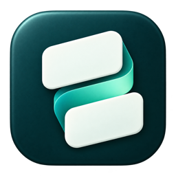
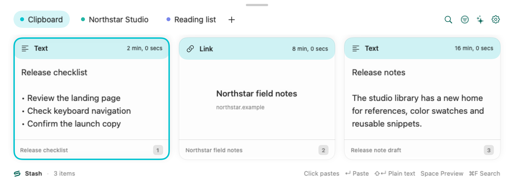
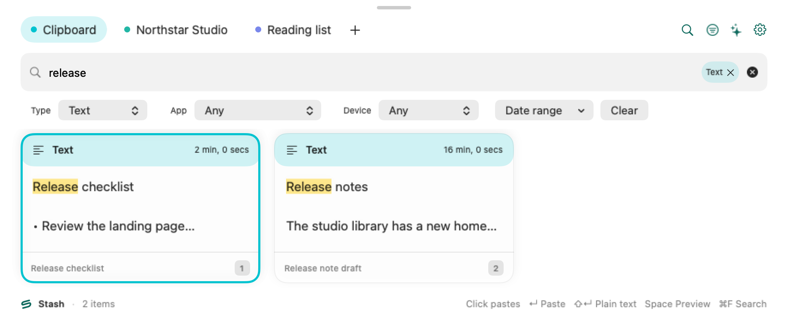
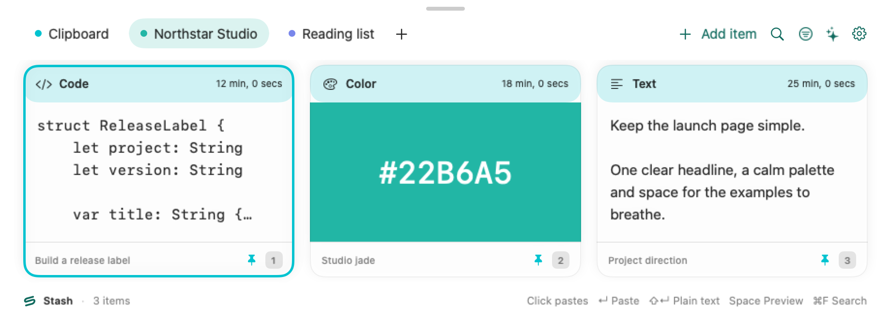
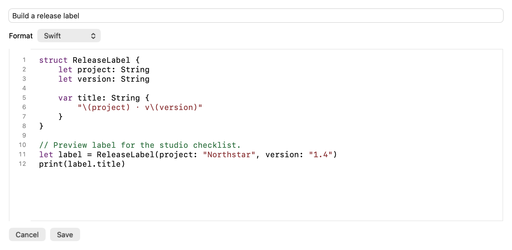
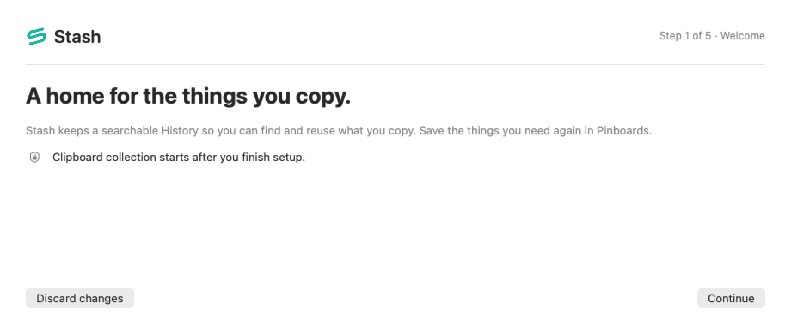
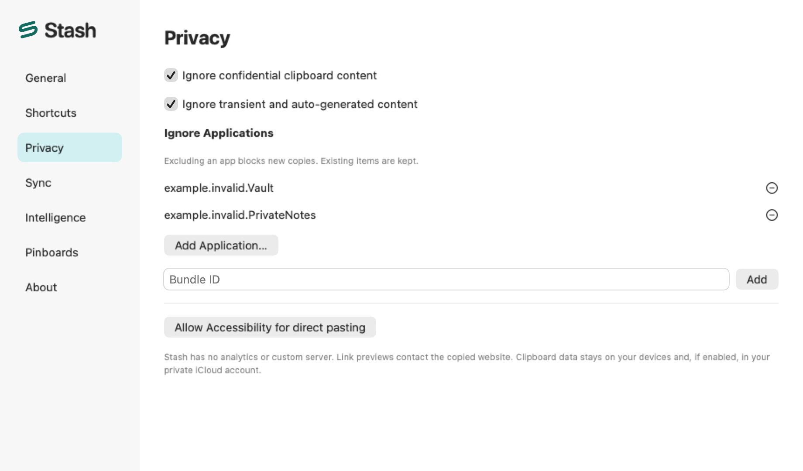

<div align="center">
  
  <h1>Stash</h1>
  <p><strong>A home for the things you copy.</strong></p>
  <p>Native clipboard history and reusable Pinboards for Mac, iPhone, and iPad.</p>
</div>

**Development release · macOS 14+ · iOS and iPadOS 17+**

Keep recent copies within reach, save useful clips to Pinboards, and find them again by what they contain. Stash keeps the library on your device by default. See the [acceptance report](docs/ACCEPTANCE.md) for what has been verified and what still needs testing.



*Recent copies appear in the Clipboard tab. Open it from the menu bar or with ⇧⌘V.*

## Find what you copied

Search clip content, titles, and recognized text in images. Narrow the results by content type, source app, device, or date. Press Space to preview an item.



*Search for a word or phrase and combine it with filters.*

## Keep reusable clips on Pinboards

Save text, links, code, images, and file references on named boards. Use **Add item** or **⌘N** inside a writable Pinboard to create a text item directly on that board.



*Collect the pieces of a project in one Pinboard.*

## Edit text and code on Mac

Choose plain text, rich text, or a code language. The Code editor shows syntax highlighting, line numbers, and indentation while keeping the copied source as text.



*Edit and save a Swift snippet for reuse.*

## Install

| Platform | How to get started |
| --- | --- |
| Mac · macOS 14+ | Choose an available development build on [GitHub Releases](https://github.com/kfathy194/stash/releases). Open the DMG and drag Stash into Applications, or extract the ZIP and move Stash there. |
| iPhone and iPad · iOS or iPadOS 17+ | Build and sign the iOS app and extensions with your Apple Developer team. Follow the [signing and cloud setup guide](docs/USAGE.md#apple-signing-and-cloud-setup). |

The Mac development package uses an ad-hoc signature and local storage. Developer ID signing, notarization, and the entitlement profile for iCloud sync and sharing require separate provisioning. [Release details](docs/RELEASES.md)

## First setup on Mac

The current source includes **Stash Setup**, which opens before clipboard capture starts for a new Mac library. Older development packages can open directly to Clipboard. The five steps cover retention and app exclusions, daily shortcuts and launch at login, optional Accessibility permission for direct paste, and a final review. Finish opens the Clipboard tab with an optional guide and links to Settings for iCloud, Suggestions, MCP, and imports. Clipboard contents that predate Finish are skipped.



*First setup introduces History and Pinboards before clipboard capture starts.*

During first setup, you can close the window at any step and choose **Resume Setup** from the menu bar to continue. Existing Mac libraries open normally. Choose **Settings → General → Setup Wizard…** to review or change setup choices.

Accessibility can be skipped. Stash can copy a selected clip for you to paste with **⌘V**. If macOS rejects a shortcut or launch at login, retry or choose the offered fallback. A failed settings save leaves the draft available and keeps first setup pending. [Setup and recovery details](docs/USAGE.md#mac-setup-and-recovery)

## Everyday use

| Action on Mac | Default shortcut |
| --- | --- |
| Open or hide Stash | ⇧⌘V |
| Paste the selected clip | Return |
| Paste plain text | ⇧Return |
| Paste a numbered clip | ⌘1–9 |
| Preview | Space |
| Find a clip | ⌘F |
| Start or stop Paste Stack | ⇧⌘C |

Launch Stash, copy something, and open the Clipboard tab. Accessibility permission enables direct paste into a compatible previous app. Without it, Stash copies the selected clip so you can paste it yourself. Paste Stack queues successive copies in order. With Accessibility enabled, use ⌘V to consume the next item.

On **iPhone and iPad**, add clips using the app's Paste control or Share Sheet extension. The optional Stash keyboard browses saved clips, inserts text, and copies images and files so you can paste them manually. Full Access lets it read the shared library on the device. [Mobile controls and extension details](docs/USAGE.md#iphone-and-ipad)

## Privacy and storage

Choose how long to keep History, pause capture, or exclude individual applications. The default capture rules skip confidential and transient content. Excluding an app affects future copies. Use **Settings → General** to export a private backup, merge a Stash archive, or migrate a supported PasteBar backup. File references alone do not preserve the original files. [Data, backups, and migration](docs/USAGE.md#data-and-privacy)



*Review capture protections and excluded applications in Privacy settings.*

Optional integrations have their own settings and prerequisites.

- **iCloud sync and shared Pinboards** require a properly provisioned build and Apple account. The automated local-only Mac package uses the device library. [Cloud setup](docs/USAGE.md#apple-signing-and-cloud-setup)
- **Suggestions** requires macOS 26, Apple Intelligence, and Screen Recording permission for active-window context. Screen context is used for the current request. [Acceptance report](docs/ACCEPTANCE.md)
- **Local MCP** runs on loopback when enabled. Approve each client and grant its read and write scopes independently. [MCP setup](docs/USAGE.md#mcp)

## Develop Stash

Open `Stash.xcodeproj` in Xcode 26 or later and select **StashMac** or **StashIOS**. Stash uses Swift 6 and Apple frameworks, with a shared local `StashCore` package.

```sh
bash Scripts/verify.sh
```

The verification script runs the automated checks and unsigned Mac and iOS builds. StoreKit support is disabled by default, with provisioning and purchase acceptance still outstanding. [Build, provisioning, and implementation notes](docs/USAGE.md) · [Release information](docs/RELEASES.md) · [Branding](Branding/README.md)

The gallery uses generated records rendered with the production views. [Regenerate the screenshots](docs/gallery/README.md)

## License

Stash is licensed under the [MIT License](LICENSE). You may use, modify, and
redistribute it, including commercially, while retaining the copyright and
license notice.
